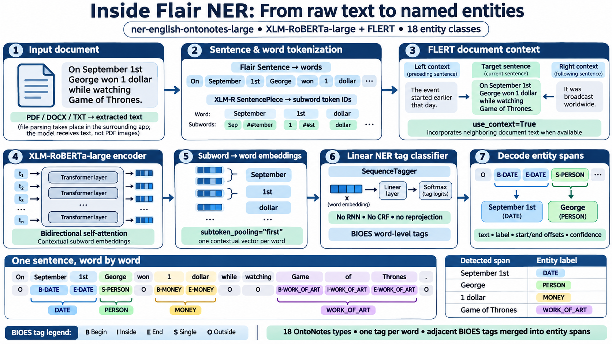
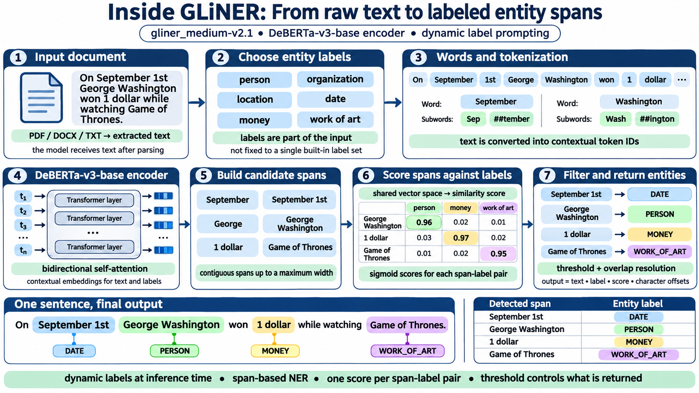

# Architecture and Method

> **Project:** `ner-app` — local document named entity recognition (NER)  
> **Scope:** architecture, inference methods, training data, evaluation, and limitations. For installation and usage, see [`README.md`](README.md).  
> **Evidence convention:** model architecture is described using the linked upstream sources. Configuration, training details, timings, test counts and benchmark scores are **recorded project results** from the provided `README.md` and `Architecture.md`. They are retained unchanged; they were not rerun as part of this documentation edit.

## 1. Overview

`ner-app` reads TXT, Markdown, HTML, DOCX, and text-based PDF documents; extracts and normalizes their text; analyzes the text with one of three interchangeable NER backends; and returns labeled entity mentions, character offsets, scores, and groupings of repeated entity text.

- **Flair (default):** `flair/ner-english-ontonotes-large` — sequence labeling against 18 OntoNotes entity types.
- **GLiNER:** `urchade/gliner_medium-v2.1` — predicts candidate spans matching entity-type prompts provided at inference time.
- **Fine-tuned GLiNER:** `models/gliner-nuner-v1` (configurable) — a locally fine-tuned GLiNER checkpoint targeting 10 entity types.

Inference is intended to run locally after the required model files are available. **A first model download, optional dataset downloads, and package installation generally require network access.** Neither the project documentation nor the fact that the model itself runs locally proves that all third-party network requests are disabled; audit your application and dependency configuration before making an absolute privacy or offline guarantee.

## 2. End-to-end system architecture

```text
Input document (TXT / MD / HTML / DOCX / text PDF)
   |
   v
Ingestion: file validation + format-specific text extraction
   |
   v
Normalization: encoding, Unicode, and whitespace handling
   |
   v
Character-based overlapping windows (application-level choice)
   |
   v
Select one inference backend:
   +-- Flair: transformer embeddings -> BIOES word tags -> spans
   +-- GLiNER: labels + text -> candidate spans -> span/label scores
   +-- Fine-tuned GLiNER: same core inference architecture, new weights
   |
   v
Post-processing: offset adjustment, overlap resolution, label mapping,
                 and optional exact-text grouping
   |
   v
Validated result: mentions (text, label, start, end, score), groups,
                  document/model metadata, extraction warnings
   |
   +-- CLI: text / JSON
   +-- Local web UI
```

| Layer | Project-reported location | Responsibility |
|---|---|---|
| Ingestion | `src/ner_app/ingestion/` | File/size validation, extractors, decoding, text normalization, warnings |
| Inference | `src/ner_app/inference/` | Flair and GLiNER adapters, chunking, backend selection, overlap handling |
| Shared data models | `src/ner_app/models.py` | Validation and common output contract |
| Pipeline | `src/ner_app/pipeline.py` | Coordinates ingestion, inference, and results |
| Interfaces | `src/ner_app/cli.py`, `web.py`, `web_page.py` | CLI and local browser access |

### 2.1 Input and offset contract

- File protections **reported by this project**: 25 MB input limit, 5,000,000 extracted characters, 1,000 PDF pages, and additional DOCX archive checks.
- Scanned/image-only PDFs do not undergo OCR; incomplete or empty extraction should be surfaced as a warning.
- Output offsets are **zero-based, end-exclusive Python string indices into the normalized extracted text**: for example, `normalized_text[start:end]` should equal the reported mention text. They are **not** byte offsets, PDF coordinates, or positions in an original DOCX file.
- Normalization, line-break changes, and HTML/Office extraction can change the text and therefore the positions of entities. Preserve the exact normalized text if offsets must be reproducible.

### 2.2 Long documents and overlap

| Backend | Reported default window | Reported overlap | Important caveat |
|---|---:|---:|---|
| Flair | 10,000 characters | 256 characters | Each chunk is still constrained by the transformer and contextualization implementation. |
| GLiNER (both variants) | 1,000 characters | 200 characters | Character length does **not** guarantee compliance with GLiNER's token input limit. |

The project documentation specifies that predictions from neighboring windows are assigned document-global offsets and conflicting overlaps are resolved by **longest span first, then higher score**. This is the application's reported policy, not a general model requirement. It can remove a correct shorter entity and should be validated on boundary cases. For duplicate spans with the same boundaries and label, retaining the highest score is a common alternative.

**Important:** The stock `gliner_medium-v2.1` configuration has `max_len: 384` and `max_width: 12`. The latter limits candidate span width; neither setting represents a number of characters. Validate GLiNER inputs using its actual preprocessing/token accounting. Token-aware, boundary-aware windows are preferable to fixed character windows for long documents. An entity crossing a chunk boundary can still be missed even when windows overlap.

## 3. Inference backends: internals

### 3.1 Flair — `flair/ner-english-ontonotes-large` (default)



*Figure 1. Conceptual Flair inference flow. The subword spellings and sample outputs in this generated illustration are schematic, not a trace of the checkpoint's exact tokenizer or a verified prediction.*

**Published model details**

- **Task:** English NER with 18 fixed OntoNotes labels: `PERSON`, `NORP`, `FAC`, `ORG`, `GPE`, `LOC`, `PRODUCT`, `EVENT`, `WORK_OF_ART`, `LAW`, `LANGUAGE`, `DATE`, `TIME`, `PERCENT`, `MONEY`, `QUANTITY`, `ORDINAL`, `CARDINAL`.
- **Encoder:** `xlm-roberta-large`, a bidirectional multilingual transformer (24 layers, 1024 hidden dimensions, 16 attention heads; roughly 550–560 million encoder parameters; ~250,000-piece SentencePiece vocabulary).
- **FLERT-style document context:** the published training script sets `TransformerWordEmbeddings(..., layers="-1", subtoken_pooling="first", fine_tune=True, use_context=True)`.
- **Classifier:** Flair `SequenceTagger`, with `use_crf=False`, `use_rnn=False`, and `reproject_embeddings=False` in the model-card training recipe. Contextual word embeddings feed a linear classification head.
- **Training reported by model authors:** OntoNotes 5.0, 20 epochs, learning rate `5e-6`, mini-batch size 4, AdamW, `OneCycleLR`; reported OntoNotes F1 **90.93**. This is **not** the F1 of `ner-app` on its own test documents.

**Inference sequence**

1. The application extracts plain text and passes sentences/text to Flair (the surrounding code determines sentence and chunk boundaries).
2. Flair tokenizes into words. XLM-R's SentencePiece tokenizer maps words to one or more subword token IDs. The generated images illustrate this concept, but `##`-style pieces are **not literal XLM-R SentencePiece output**.
3. When surrounding sentences are supplied appropriately, the FLERT embedding component can use **document context** around the target sentence. `use_context=True` in the upstream model recipe does **not**, by itself, prove that the application preserves adjacent-sentence context across separate chunks.
4. XLM-R computes contextual subword vectors using bidirectional self-attention. The first subword vector provides the representation for each word.
5. A linear head produces scores for BIOES word labels (`B`, `I`, `E`, `S`) and the outside tag `O`; there is no additional RNN or CRF in this checkpoint's published configuration.
6. BIOES tags are decoded into contiguous entity spans and confidence scores. The confidence is a model-derived score, **not a calibrated real-world probability**.

**About “76 tags”:** 18 entity types × 4 BIOES boundary variants = 72 typed tags; `O` adds one more. If a saved tag dictionary contains 76 entries, the additional entries are special/reserved dictionary items. Do **not** assert their exact number or names from arithmetic alone. To verify the deployed file, inspect `tagger.label_dictionary.get_items()` in the installed Flair version.

**Important distinction:** Flair is a *fixed-output-label* architecture here. It cannot be given a new `technology` category at inference time just by supplying a prompt. Additional labels require model adaptation/retraining or separate post-processing.

Sources: [Flair OntoNotes Large model card](https://huggingface.co/flair/ner-english-ontonotes-large) · [FLERT paper](https://arxiv.org/abs/2011.06993) · [XLM-R paper](https://arxiv.org/abs/1911.02116).

### 3.2 Base GLiNER — `urchade/gliner_medium-v2.1`



*Figure 2. Conceptual GLiNER span-based inference flow. The per-label score values are illustrative, not recorded model outputs; the displayed subword fragments are schematic, not literal DeBERTa tokenizer output.*

**Published model details**

- **Architecture:** original GLiNER *uni-encoder span model*. Entity-type labels and document text are supplied in one encoder input, separated with dedicated markers such as `[ENT]` and `[SEP]`.
- **Encoder:** bidirectional `microsoft/deberta-v3-base`; approximately **209 million parameters** for the complete medium-v2.1 model.
- **Checkpoint configuration:** `max_len: 384`, `max_width: 12`, `subtoken_pooling: "first"`, and `span_mode: "markerV0"`.
- **Span scoring:** representations of candidate start/end tokens and entity-type representations are projected by feed-forward networks. Each candidate span/type pair gets a compatibility score (dot product followed by sigmoid in the original span architecture).
- **Labels:** entity type strings are supplied at runtime; changing labels does not require training new classifier classes, although prompt wording changes predictions.
- **Decoding:** filter by threshold and select compatible span hypotheses. The application/GLiNER decoding configuration determines whether overlapping or nested outputs are allowed; do not describe non-overlapping greedy decoding as the only possible GLiNER mode.
- **License/model data:** medium-v2.1 is published as Apache-2.0; the specific model card associates it with `urchade/pile-mistral-v0.1`. The foundational GLiNER work discusses LLM-annotated Pile-NER-style training, but this does not establish that the v2.1 checkpoint was trained *only* on the original Pile-NER dataset.

**Inference sequence**

1. Receive text **and requested entity-type names**, e.g., `person`, `organization`, `date`, `technology`.
2. Split the text into word-level units, then encode tokens/subtokens; serialize entity labels and text into the uni-encoder input with entity markers.
3. DeBERTa-v3-base constructs contextual representations of both labels and words.
4. Build **candidate contiguous spans** up to the configured span width.
5. Score every permitted candidate span against each requested label.
6. Filter and decode hypotheses, returning text, label, score, and start/end character offsets.

GLiNER is **not** a dictionary lookup. It does not guarantee that arbitrarily phrased labels will work equally well. Poor label descriptions, truncation, and changed thresholds can produce different outputs.

**Default label set documented for `--backend gliner`:** `PERSON`, `ORG`, `GPE`, `DATE`, `TIME`, `MONEY`, `PERCENT`, `QUANTITY`, `PRODUCT`, `EVENT`, `LAW` (11 labels). The README says `--labels` overrides this set. Confirm the precise prompt strings and output label mapping in `gliner_ner.py` before claiming these uppercase names are the literal model prompts.

Sources: [GLiNER medium-v2.1 model card](https://huggingface.co/urchade/gliner_medium-v2.1) · [checkpoint configuration](https://huggingface.co/urchade/gliner_medium-v2.1/blob/main/gliner_config.json) · [GLiNER architecture documentation](https://github.com/urchade/GLiNER/blob/main/docs/architectures.md) · [GLiNER long-input guidance](https://github.com/urchade/GLiNER/blob/main/docs/usage.md).

### 3.3 Project fine-tuned GLiNER — `gliner-nuner`

The fine-tuned version **retains the base GLiNER span-scoring architecture**; it does not become a Flair-style BIOES classifier. Fine-tuning changes model weights, whereas threshold and honorific rules are later inference/post-processing choices.

**Training pipeline used in this project (recorded results)**

1. Start from `urchade/gliner_medium-v2.1` and NuNER's `entity` split.
2. Map free-form NuNER entity concepts into 10 project categories: `person`, `organization`, `location`, `date`, `time`, `event`, `product`, `technology`, `quantity`, `money`.
3. Align extracted entity strings to whole tokens. The project reports 0 tokenizer mismatches across a 2,000-text spot-check, and labels all matching occurrences of each string.
4. Drop examples with unmapped, unaligned, or contradictory annotations, to avoid training on omitted positives as if they were negatives.
5. Retain **61,441** examples from 1,000,000 source rows: **55,280 train**, **3,167 validation**, **2,994 test**. Project notes describe assigning splits using a SHA-256 hash of text, preventing **identical raw text** from crossing splits; this does not rule out near-duplicates or label leakage.
6. Sample **8,000** training examples with increased representation for rarer labels; train for **1,000 optimizer steps**, effective batch size 8 (micro-batch 1 × gradient accumulation 8).
7. Project-reported optimizer settings: encoder LR `5e-6`, other-layer LR `1e-5`, weight decay `0.01`, linear schedule, 10% warm-up, gradient clipping 1.0, fp32 on an NVIDIA GTX 1650 4 GB.
8. Select thresholds on the **validation** split; project notes report global **0.65**, technology **0.55**, in `label_thresholds.json`; remove honorific prefixes such as `Dr.` and `Prof.` from `PERSON` mentions during post-processing.

**Runtime label mapping:** the project reports fine-tuned `location` as `GPE`; percentages are covered, if at all, under `quantity` rather than a distinct `PERCENT` class. This makes cross-model evaluation sensitive to how a common gold-label taxonomy is defined.

**Threshold caveat:** The supplied README reports a **0.7** threshold for the seven-document fine-tuned GLiNER comparison. This is not the same operating point as the default **0.65** global threshold. Record the effective threshold in every evaluation table and distinguish the saved per-label thresholds from explicit CLI overrides. The README's `--threshold` behavior (“other than 0.5 overrides them”) is also a project implementation rule to confirm from code.

### 3.4 Flair vs. GLiNER at a glance

| Question | Flair OntoNotes Large | Base / fine-tuned GLiNER |
|---|---|---|
| How does the model recognize a category? | Predicts BIOES word tags belonging to a fixed set of 18 types | Scores candidate contiguous spans against label-text representations |
| Are new categories available by prompting? | No | Yes, though quality varies and the fine-tuned application may expose a fixed set |
| What forms the main representation? | XLM-R contextual **word** embeddings | DeBERTa contextual **label + span** representations |
| How are multiword entities joined? | BIOES tag decoding | Candidate start/end span selection |
| Does model inference read a PDF file? | No: surrounding app extracts text | No: surrounding app extracts text |
| Main long-document concern | Available sentence/document context and token limits | Text-token budget, label budget, max candidate span width |

## 4. Datasets and licenses

| Dataset | Published content | Role in this project | License / access |
|---|---|---|---|
| [NuNER](https://huggingface.co/datasets/numind/NuNER), `entity` split | ~1 million C4 web sentences annotated with GPT-3.5; ~4.38M annotations and ~200k concepts reported in the paper | Project-reported fine-tuning and held-out test material | Dataset and NuNER work are released under MIT, per authors; verify specific assets and upstream C4 terms before redistribution |
| [OntoNotes 5.0](https://catalog.ldc.upenn.edu/LDC2013T19) | Multiple genres of English text with 18 conventional NER categories | Upstream training corpus for published Flair checkpoint | Licensed through LDC; not automatically distributed with this project |
| Pile-derived, LLM-annotated data | Data family used by the original GLiNER research; v2.1 points to [`urchade/pile-mistral-v0.1`](https://huggingface.co/datasets/urchade/pile-mistral-v0.1) | Upstream data, not part of this project's local fine-tuning | Check checkpoint/data-specific license and provenance |
| Handmade evaluation documents | Seven documents with **76 project-reported gold entities**, plus separate examples | Informal in-domain comparison | Project-owned; gold source files reportedly omitted from repository |

The NuNER labels are **machine-generated, not comprehensive human truth**. Missing/inconsistent annotations mean that F1 against NuNER measures agreement with that label set, and may not predict performance on real documents.

## 5. Evaluation protocol and reported results

### 5.1 Define the metric before comparing models

For a scored entity mention, use:

- **Precision** = true positives / (true positives + false positives)
- **Recall** = true positives / (true positives + false negatives)
- **F1** = `2 × precision × recall / (precision + recall)`

There are **two distinct matching definitions** in the supplied documentation:

1. `scripts/evaluate.py` in the supplied README matches **exact surface text + exact label** and **ignores offsets**. The same string appearing twice cannot be reliably distinguished by location; this is **not** strict boundary-and-position matching.
2. The architecture note says **strict exact span + label**, which ordinarily means matching normalized-text `(start, end, label)` with one-to-one matching of occurrences.

**Correction:** do not describe both as the same metric. This document calls the current handmade comparison **documented exact-text/label comparison**, while noting that the exact implementation of `scripts/suite_compare.py` has not been inspected. Before reporting formal strict span F1, verify whether that script checks offsets and handles repeated mentions one-to-one. Train/validation/test comparisons should apply the *same* defined metric and category mapping to every model.

### 5.2 Recorded project measurements

| Dataset / comparison | Base GLiNER | Fine-tuned GLiNER | Flair |
|---|---:|---:|---:|
| NuNER held-out test F1 | **0.656** | **0.701** | Not directly comparable: different label inventory |
| Seven handmade documents: correct entities reported out of 76 | **57 / 76** | **61 / 76** | **68 / 76** |
| Seven handmade documents: reported F1 (README) | **0.814** | **0.836** | **0.883** |
| Hard paragraph: reported entities found out of 29 | **24 / 29** | **24 / 29** | **25 / 29** |

**Evaluation conditions matter:** The README explicitly lists **0.7** for fine-tuned GLiNER in the seven-document F1 comparison, while default saved thresholds are 0.65 globally and 0.55 for technology. The counts, F1 scores and hard-paragraph results are reproduced *as reported*; whether they share precisely the same threshold, label mappings, and matching method must be confirmed against the evaluation scripts and logs.

“68 out of 76” is a **count of matched gold entities**, not accuracy or F1 by itself. F1 depends on false positives too. The OntoNotes **90.93** published Flair result, the NuNER **0.701** test result, and the project handmade **0.883** result come from **different datasets and protocols**, and cannot be ranked as if they were one benchmark.

### 5.3 Reliability

- Seven project-written documents are a **small, non-independent evaluation set**; their OntoNotes-like category definitions may favor Flair.
- The README records another news-style test at F1 0.86 (32 entities), and visual checks on an exam PDF, but these are not controlled benchmarks.
- **Do not claim** that F1 differences under 0.01 are statistically insignificant or “sampling noise” without uncertainty estimates such as document-level bootstrap intervals.
- Select thresholds using validation data only. Do not repeatedly tune labels, mapping, prompts, or thresholds on the final test set.
- Track per-label precision, recall, F1, boundary errors, false positives, omitted entities, and inference time; record checkpoint, package versions, device, chunking, thresholds, and scorer version with every run.

The current evidence supports selecting Flair as the **practical default in this small project test**, not the universal conclusion that Flair is more accurate than GLiNER.

## 6. Engineering and operational properties

The following engineering and runtime observations are taken from the project's recorded results (not re-measured in this documentation edit):

- **92** automated tests most recently passed. Fake-model tests cover ingestion, offsets, windows, grouping, backend selection, CLI, and web wiring. They do **not** validate real-model NER quality.
- A local browser UI binds to `127.0.0.1` and processes one request at a time. Uploaded temporary files are reportedly cleaned up after each request.
- Python **3.13.7** and Flair **0.15.1** were tested in a CPU-only Windows runtime for the default backend. The project reports model load times around **30–40 s** and around **1.7 ms per character** for one machine. These are hardware- and document-dependent measurements, not portable benchmarks.
- A separate CUDA environment on an NVIDIA **GTX 1650, 4 GB** was used for the fine-tuning script. CPU-only inference and GPU training are **different environments**.
- Model weights and generated data are excluded from the version-controlled repository.

## 7. Known limitations and suggested next steps

1. **Unreliable boundaries:** Fixed character windows can split words, sentences, or entities. Token-/sentence-aware windows and robust deduplication would reduce losses at boundaries.
2. **No OCR:** Image-only/scanned PDFs need a separate OCR stage if supported in future.
3. **Normalization offsets:** Spans refer to extracted normalized text, not visual page coordinates; character/byte offsets, page references, and original-source positions should not be conflated.
4. **Uncalibrated confidence:** A high sigmoid or softmax-derived score can still be wrong. Thresholds should be tuned and evaluated per label/domain.
5. **Domain mismatch:** Technical terms, Indian institutions, names, and currency forms are under-represented relative to common news-domain examples.
6. **Different taxonomies:** Flair has `PERCENT`, `GPE`, `LOC`, etc.; the fine-tuned GLiNER has 10 categories, with `location → GPE` and percent-like values mapped to `quantity` in the app. Make a comparison mapping explicit rather than silently treating mismatches as model errors.
7. **Partial annotation:** NuNER's machine labels omit/misclassify some entities; filtering may also skew the distribution toward simpler examples.
8. **Score/report provenance:** Keep the exact suite and script versions, hand-annotated gold files, seeds, split hashes, thresholds, and model revision available for reproducing published numbers (subject to privacy restrictions).
9. **Privacy claims:** For a strong offline statement, explicitly test a complete inference session with network access disabled after dependency/model setup.
10. **Next benchmark:** Build a larger, independently hand-labeled set of actual target documents; use a common label ontology and offset-aware, one-to-one matching; report per-model resource usage and paired confidence intervals.

### Examples of errors observed in project tests

- `30 marks` reported as MONEY; a course code reported as CARDINAL.
- `Rs 1,500` returned without its currency prefix.
- A longer institutional name cut short at an entity boundary.
- `Azure OpenAI Service` split into multiple spans.
- Heading numbers tagged as CARDINAL.

These are **reported examples**, not independently reproduced during this documentation review. Some may be model errors; others can also be exacerbated by text extraction, windowing, or post-processing. Diagnose the intermediate normalized text and raw per-chunk predictions before attributing every error to the model.

## 8. References

1. Schweter, S. and Akbik, A. (2020). [*FLERT: Document-Level Features for Named Entity Recognition*](https://arxiv.org/abs/2011.06993).
2. Conneau, A. et al. (2019). [*Unsupervised Cross-lingual Representation Learning at Scale*](https://arxiv.org/abs/1911.02116).
3. Zaratiana, U. et al. (2023). [*GLiNER: Generalist Model for Named Entity Recognition using Bidirectional Transformer*](https://arxiv.org/abs/2311.08526).
4. Bogdanov, S. et al. (2024). [*NuNER: Entity Recognition Encoder Pre-training via LLM-Annotated Data*](https://aclanthology.org/2024.emnlp-main.660/).
5. Weischedel, R. et al. (2013). [*OntoNotes Release 5.0*](https://catalog.ldc.upenn.edu/LDC2013T19).
6. [Flair — `ner-english-ontonotes-large` model card and training recipe](https://huggingface.co/flair/ner-english-ontonotes-large).
7. [GLiNER — `gliner_medium-v2.1` model card](https://huggingface.co/urchade/gliner_medium-v2.1) and [configuration](https://huggingface.co/urchade/gliner_medium-v2.1/blob/main/gliner_config.json).
8. [GLiNER architecture documentation](https://github.com/urchade/GLiNER/blob/main/docs/architectures.md) and [long-input/usage guidance](https://github.com/urchade/GLiNER/blob/main/docs/usage.md).
9. [NuNER Hugging Face dataset card](https://huggingface.co/datasets/numind/NuNER).

---

*Documentation updated from the original project files. All numerical experiment results are preserved as recorded; model source code, trained weights and the benchmark scripts were not rerun or modified.*
