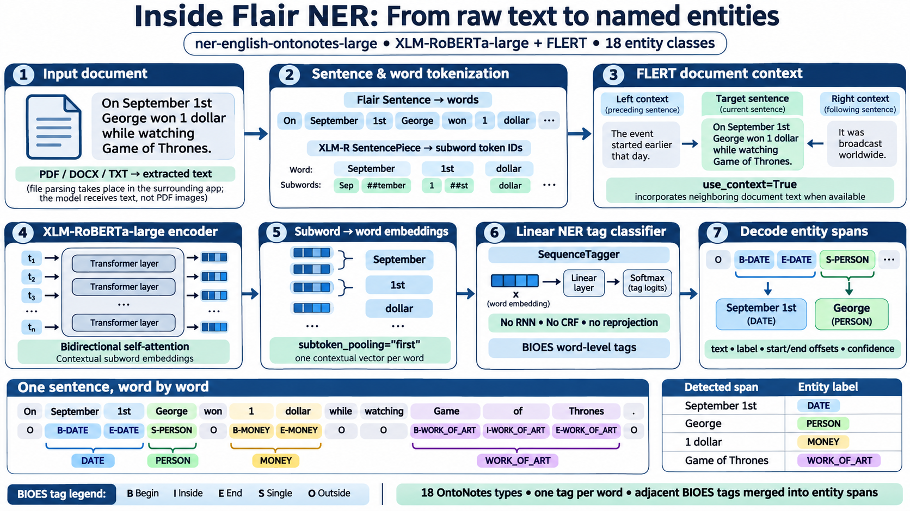
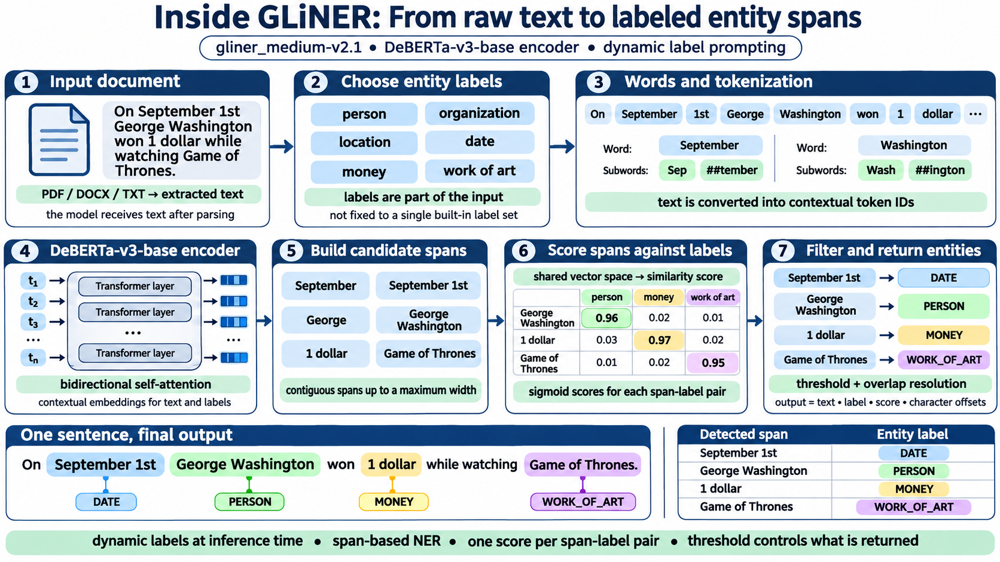

# ner-app

A local, privacy-focused tool for English named entity recognition (NER). It reads a
document, extracts its text, runs an NER model (Flair by default, or an optional
GLiNER model), and reports each entity with its label and exact character offsets. It
has a command-line interface and a local web interface. The application runs inference locally without sending the document to a remote NER
service after the models are downloaded. Initial model and optional dataset downloads
require network access; test with networking disabled if strict offline operation is required.

## Requirements

- Python 3.13 (developed and tested on Python 3.13.7, Windows, CPU only).
  `pyproject.toml` allows Python 3.10 and later, but other versions are untested.
- Roughly 2.2 GB of disk space for the default model weights (the published model
  file is about 2.24 GB), plus room for PyTorch, caches, and dependencies.
- Flair 0.15.x (tested with 0.15.1) and PyTorch (tested with 2.14.1).
- Optional: GLiNER, for the `gliner` and `gliner-nuner` backends (see below).

## Installation

```bash
python -m venv .venv
source .venv/bin/activate        # Windows (Git Bash): source .venv/Scripts/activate
pip install -e .                 # command-line tool only
pip install -e ".[web]"          # adds the local web interface
pip install -e ".[gliner]"       # adds the optional GLiNER backends
pip install -e ".[dev]"          # adds pytest and httpx for the tests
```

You can combine extras, for example `pip install -e ".[web,gliner,dev]"`.

### First run and model download

The default model is `flair/ner-english-ontonotes-large`. It is downloaded
automatically the first time you analyze a document and cached under `~/.flair`
(about 2.1 GB on the tested machine). Later runs reuse the cache.

### Speed

Measured on a CPU-only Windows machine (no GPU):

| Step | Time |
|------|------|
| Model load | about 30-40 seconds, once per process |
| Analysis | roughly 1.7 ms per character (about 10 seconds per 6,000 characters) |

A one-page file takes a few seconds, a 17,000-character file about 30 seconds, and a
long PDF can take many minutes. In one 17,000-character test, the reported times
were about 23 seconds using 1,000-character chunks and 30 seconds using
10,000-character chunks. This is one measurement, not a general performance rule.

## Which engine runs

One engine is chosen when the program starts, loaded once, and used for everything
until the program stops. The default is Flair. The other engines are never loaded
unless you ask for them.

| Command | Model that runs |
|---------|-----------------|
| `ner-app analyze FILE` or `ner-app-web` | Flair: `flair/ner-english-ontonotes-large` |
| `... --backend gliner` | GLiNER `urchade/gliner_medium-v2.1` with your own labels (default: eleven OntoNotes-style labels) |
| `... --backend gliner-nuner` | The fine-tuned GLiNER model in `models/gliner-nuner-v1` |

To compare engines in the browser, start two web instances on different ports. Each
loads only its own model.

On our small hand-made suite (see "Results so far") Flair found the most entities, so
it remains the default.

## How the models recognize entities

The application handles **document extraction, normalization, overlapping windows,
character-offset adjustment, and result grouping**. The inference backends do the
actual named-entity recognition after receiving text; they do not parse PDFs or DOCX
files themselves.

- **Flair (`flair/ner-english-ontonotes-large`)** uses XLM-RoBERTa-large with FLERT
  contextual embeddings. It predicts word-level BIOES tags over **18 fixed OntoNotes
  entity types**, and converts those tags into entity spans. Its published training
  configuration uses a linear head, **without an RNN or CRF**.
- **Base GLiNER (`urchade/gliner_medium-v2.1`)** combines the requested label names and
  text in a DeBERTa-v3-base encoder, scores candidate contiguous spans against the
  labels, and filters them by threshold. It supports different label prompts without
  retraining, though results depend on the label wording. Its published configuration
  includes `max_len=384` and `max_width=12` (token-related, not character counts).
- **Fine-tuned GLiNER (`gliner-nuner`)** keeps GLiNER's span-based architecture but uses
  weights fine-tuned on NuNER examples mapped to ten project-specific labels.
  Post-training thresholds and title stripping are application-level decisions.

### Architecture diagrams



*Flair: conceptual model pipeline, not a byte-for-byte tokenizer trace or a live model prediction.*



*GLiNER: conceptual span-scoring pipeline. Example score values and subword spellings are illustrative.*

For the complete system design, model internals, datasets, training settings, and
an explanation of evaluation metrics, see **[Architecture and Method](Architecture.md)**.

## Command-line usage

```bash
ner-app analyze FILE [--format text|json] [--backend flair|gliner|gliner-nuner]
                     [--model MODEL_ID] [--threshold T] [--labels 'NAME=Prompt,...']
                     [--chunk-size N] [--chunk-overlap N]
```

`python -m ner_app analyze FILE` works too. `--threshold` applies to the GLiNER
backends, and `--labels` only to `--backend gliner`.

Example:

```text
$ ner-app analyze samples/sample.html
Document: sample.html (html, 137 characters)
Model: flair/ner-english-ontonotes-large (Flair 0.15.1)
Entities found: 7
  DATE: 2
  GPE: 1
  MONEY: 1
  ORG: 1
  PERCENT: 1
  PERSON: 1

Mentions:
  #0  DATE  'Quarterly'  [0:9]  score 0.998
  #1  PERSON  'Jane Smith'  [18:28]  score 1.000
  ...
```

Note that `'Quarterly'` is a model mistake (a heading read as a date). Review the output
before relying on it.

### JSON output

`--format json` writes the full structured result to stdout. Logs and errors go to
stderr, so the output can be piped:

```bash
ner-app analyze report.docx --format json > result.json
```

The JSON contains the document info (including any extraction warnings), model info,
every mention, and exact-text groupings of repeated entities. Groups never replace the
original mentions.

### Advanced options

Long documents are processed in overlapping character chunks.
`--chunk-size` (default 10,000 for Flair, 1,000 for GLiNER) and `--chunk-overlap`
(default 256 for Flair, 200 for GLiNER) control this. The overlap must be smaller than
the chunk size. `--model` selects another model ID for the chosen backend.

## Web interface

```bash
ner-app-web                                       # Flair, then open http://127.0.0.1:8000
ner-app-web --port 8080                           # use another port
ner-app-web --backend gliner-nuner --port 8001    # the fine-tuned GLiNER model instead
```

The server listens on `127.0.0.1` only, so it is reachable from your own machine and
not from the network. It is meant for one local user, with no login and no
multi-user support.

- The model is loaded once at startup. Wait for the "Model ready." message in the
  terminal (about 30-40 seconds for Flair) before opening the page.
- Drag and drop (or choose) a file, then click Analyze. A seconds counter runs while
  the model works.
- Uploads are written to a temporary folder for the duration of one request and then
  deleted. Nothing is stored.
- The page shows the text with highlighted entities, counts per label, and a table of
  mentions. Click a label chip to hide or show that label, filter the table, click a
  row to jump to its highlight, and copy or download the result as JSON. The JSON
  names the model that produced it.
- Scores under 0.5 are marked "low" in the table.
- Requests are processed one at a time. Clicking Analyze again waits for the current
  run to finish.

## Optional GLiNER backends

GLiNER lets the caller choose the labels at run time.

- `gliner` uses the base model `urchade/gliner_medium-v2.1`. Labels come from
  `--labels` or a default set of eleven (PERSON, ORG, GPE, DATE, TIME, MONEY, PERCENT,
  QUANTITY, PRODUCT, EVENT, LAW).
- `gliner-nuner` uses a version of the base model fine-tuned on a filtered part of the
  NuNER dataset (`numind/NuNER`). It is read from `models/gliner-nuner-v1` (override
  with the `NER_NUNER_MODEL` environment variable). The model weights are not part of
  this repository.
  - Its labels are person, organization, location (reported as GPE), date, time,
    event, product, technology, quantity and money. Percentages count as quantity.
  - Decision thresholds are read from `label_thresholds.json` in the model folder
    (global 0.65, technology 0.55). A `--threshold` other than 0.5 overrides them.
  - Honorifics such as Dr. and Prof. are removed from person names.

Measured results from the project's recorded tests (not cross-benchmark accuracy
claims):

- On a held-out part of the NuNER data, the base model scored F1 0.656 and the
  fine-tuned model 0.701. This measures agreement with the dataset's machine-written
  labels, which are incomplete, not real-world accuracy.
- On our seven-document hand-made suite (76 gold entity mentions), Flair matched 68,
  the fine-tuned model 61 and the base model 57 under the recorded comparison
  protocol. The fine-tuned model missed several percentages and quantities.
  The seven-document F1 comparison below used a **0.7 threshold** for the fine-tuned
  model; this differs from its saved **0.65** global/**0.55** technology thresholds.

### Scripts for fine-tuning and evaluation (optional)

These are not needed to use the tool. They need a separate environment with a
CUDA-capable PyTorch and the GLiNER training dependencies, and they download the
NuNER dataset. Check the licences of the dataset and models before using or
redistributing anything derived from them.

- `scripts/prepare_nuner_v2.py`: converts NuNER into GLiNER training data.
- `scripts/train_gliner_v2.py`: fine-tunes the model.
- `scripts/evaluate_v2.py`: scores models on the held-out data.
- `scripts/tune_thresholds.py`: chooses decision thresholds on validation data.
- `scripts/suite_compare.py`: compares models on hand-made documents with gold files.
- `scripts/error_breakdown.py`: sorts errors into label, boundary and missing-label cases.

## Supported formats

`.txt`, `.md`, `.html` (also `.htm`), `.docx`, and `.pdf`.

Default safeguards (the code reads them from `Limits`): files up to 25 MB, 5,000,000
extracted characters, and 1,000 PDF pages, plus archive checks for DOCX files.
These are starting values, not measured limits.

## Exit codes

Command-line tool:

| Code | Meaning |
|------|---------|
| 0 | Success |
| 1 | General error (for example, model loading or inference failed) |
| 2 | Problem with the input document, or invalid command-line arguments |
| 3 | A resource limit was exceeded |

The web interface maps the same errors to HTTP status codes: 422 for document
problems, 413 for resource limits (including uploads over the size limit), and 500
for anything else.

## Evaluating accuracy

`scripts/evaluate.py` compares the model's output with a hand-made answer key (a
"gold" file):

```bash
python scripts/evaluate.py DOCUMENT GOLD.json           # score
python scripts/evaluate.py DOCUMENT GOLD.json --draft   # write model output as a draft to correct
```

The gold file is a JSON list with one entry per occurrence:

```json
[
  {"label": "PERSON", "text": "Jane Smith"},
  {"label": "GPE", "text": "Berlin"}
]
```

It prints precision, recall and F1 per label, plus lists of spurious and missed
entities. In **this script**, a match requires exact entity text and label, but
**ignores offsets**; repeated occurrences of the same text cannot always be
unambiguously matched. This is **not** strict `(start, end, label)` span matching.
The separate `scripts/suite_compare.py` comparison should be described using its
own actual scoring implementation rather than assuming both scripts use identical
matching rules.
A span that differs by a leading "the" or a trailing period counts as one miss and
one spurious entity. Using `--draft` biases scores upward, because it is easy to
accept what the model already wrote, so say so when reporting such results.

### Results so far

These are small, informal checks, not an accuracy benchmark.

| Document | Result | Reliability |
|----------|--------|-------------|
| News-style test text (32 entities, written for this test) | Strict F1 0.86 (precision 0.85, recall 0.88) | Low: the text is easy for this model, and the answer key was written by the same author. It may overestimate performance on unseen text. |
| Exam paper PDF (15 mentions) | Not scored. About 9 of 15 judged correct by eye. | Very low: an impression only. |
| Design spec excerpt | Not scored | Not measured. |
| Seven hand-made documents (76 gold entities, exact label and text match, titles stripped, labels mapped to the ten-label set) | Entities found: Flair 68 (F1 0.883), fine-tuned GLiNER 61 (F1 0.836, threshold 0.7), base GLiNER 57 (F1 0.814) | Low to moderate: small, written for this project, and its OntoNotes-style labels probably favour Flair. |

Errors observed in project testing (they may originate in prediction, extraction,
chunk boundaries, or post-processing; diagnose the intermediate text and spans):

- `30 marks` labeled MONEY, and a course code labeled CARDINAL.
- A name cut short (`Institute of Information Technology` without `Babu Madhav`).
- `Rs 1,500` found as `1,500` without the currency prefix.
- `Azure OpenAI Service` split into two entities.
- Heading numbers (such as the "1" in "## 1. Design Plan") tagged as CARDINAL.

## Limitations

- **Offsets refer to the extracted, normalized text**, not to the original file.
  They are not PDF coordinates or DOCX byte positions.
- **Mention text can contain line breaks** from the source layout (for example
  `24 degrees\nCelsius` from a wrapped PDF line). The same entity with and without a
  line break is grouped as two different texts.
- **Scores are not calibrated probabilities of correctness.** Flair uses
  softmax-derived tag scores; GLiNER uses sigmoid-derived span/label scores. Either
  can be very high for an incorrect prediction.
- **Accuracy depends heavily on the text.** The default model is trained on news-style
  English. It is weaker on technical documents, exam papers, code-like text, and
  text with Indian names, institutions and currency formats.
- **The Flair label set is fixed (OntoNotes).** Things like course codes, marks or
  subjects have no label, so they are either missed or forced into the wrong one.
  The fine-tuned GLiNER backend has its own ten labels, with no separate percent or
  LOC label.
- **GLiNER chunks are small** (1,000 characters by default) because the model reads a
  limited number of tokens at once. The published medium-v2.1 configuration has
  `max_len=384`; a character window is **not** a guarantee that every input fits its
  token limit, especially when label prompts also consume tokens.
- **Chunking is by fixed character windows**, not word or sentence boundaries. Where
  chunks overlap, overlapping predictions are resolved by keeping the longest span,
  then the higher score. An entity longer than `--chunk-overlap` can still be split.
  Mention counts can differ slightly between chunk sizes.
- **Scanned PDFs are not OCR'd.** They produce a warning and no text.
- **The automated tests use fake models**, so they check wiring, offsets, grouping,
  and the overlap policy, not the real models' accuracy.
- English only.

## Development

```bash
python -m pytest -q
```

**92 tests passed** at the last full project test run. The tests use fake models,
so this is a test of application behavior, not a benchmark of model accuracy.
The project layout is:

- `src/ner_app/ingestion/`: file loading, extraction and normalization.
- `src/ner_app/inference/`: Flair and GLiNER inference, chunking and overlap handling.
- `src/ner_app/models.py`: shared result models.
- `src/ner_app/pipeline.py`: connects ingestion and inference into one result.
- `src/ner_app/cli.py`, `src/ner_app/web.py`, `src/ner_app/web_page.py`: the interfaces.
- `scripts/evaluate.py`: scoring against a gold file.
- `scripts/`: the optional GLiNER scripts listed above.

Files you want to keep private can go in `samples/real/`, which is ignored by git.
## Model documentation and provenance

- [Architecture and Method](Architecture.md) — detailed inference architectures,
  fine-tuning process, data handling, evaluation caveats, and both diagrams.
- [Flair OntoNotes Large model card](https://huggingface.co/flair/ner-english-ontonotes-large).
- [GLiNER medium-v2.1 model card](https://huggingface.co/urchade/gliner_medium-v2.1).
- [NuNER dataset card](https://huggingface.co/datasets/numind/NuNER).

The timings, experiment counts, thresholds, and F1 values in this README are the
**recorded results of this project**. They were preserved during this documentation
update; no benchmarks were rerun.
